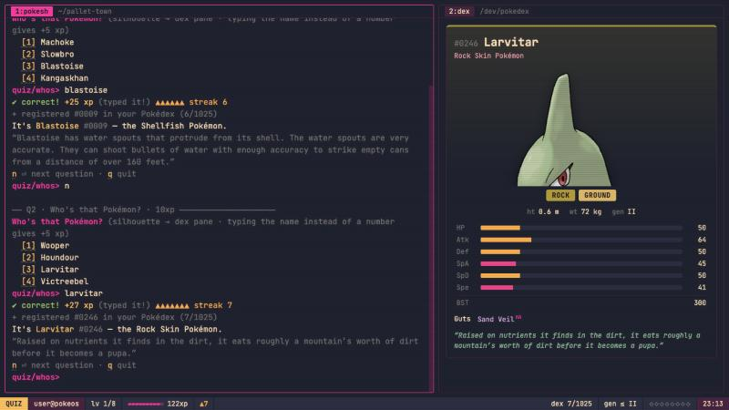

# pokéOS

A fake Linux terminal for exploring the Pokémon world, built with Vue 3 + Vite on [PokeAPI](https://pokeapi.co/docs/v2).
Pinkmare color palette. Meant as interview prep: it starts gentle and gets nerdier as you rank up.



```bash
npm install
npm run dev
```

## How it works

- **Play** (`play`): eight quiz modes, unlocked one by one as you rank up:
  `whos` → `flavor` → `type` → `stat` → `evo` → `matchup` → `ability` → `move`.
  Streaks give bonus XP; `hint` halves the XP for that question.
- **Ranks**: guest → user → trainer → wheel → gym-leader → elite-four → champion → professor → root.
  Each rank adds a generation to the Pokémon pool, plus new commands and lessons.
- **Learn** (`learn`): short, dense field notes (species vs. pokemon vs. form, the 8 type immunities,
  the stat formula, evolution triggers, natures, abilities, moves, generations, the API itself).
- **Dig** (`dex`, `evo`, `type`, `weak`, `compare`, `nature`, `gen`, `curl … | jq .path`, `verbose on`).
- Progress is saved in localStorage. Use `reset --yes` to wipe it, or `config gen 1` to practice on Kanto only.

Cheat: `sudo su` (password: `oak`) unlocks everything. `exit` drops back to your earned rank.

## Code map

- `src/lib/api.js`: fetch with an in-memory promise cache and an optional request logger
- `src/lib/poke.js`: PokeAPI helpers (type math, evolution chains, card view-models)
- `src/lib/quizzes.js`: question generators and the quiz session loop
- `src/lib/commands.js`: shell commands · `src/lib/shell.js`: parsing, completion, rank-ups
- `src/lib/learn.js`: lesson content
- `src/components/`: boot screen, terminal, Pokédex pane, status bar
